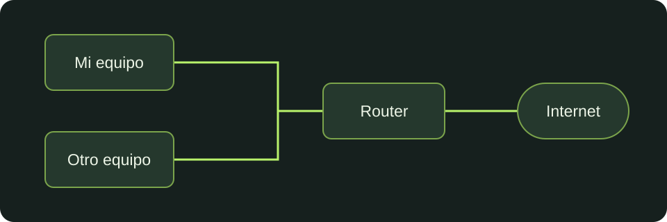

## La idea que quiero recordar

Una red permite que varios dispositivos intercambien información. Para entenderla, puedo empezar por tres preguntas: **quién envía**, **por dónde viaja** y **quién recibe**.

## Dibujar antes de memorizar



Este dibujo simplificado no representa una captura real de mi equipo. Me sirve como punto de partida para dibujar mi propia red.

| Elemento | Pregunta para mis apuntes |
| --- | --- |
| Equipo | ¿Qué información necesita enviar? |
| Conexión | ¿Usa cable o Wi-Fi? |
| Router | ¿A qué otras redes permite llegar? |

## Diferenciar dos conceptos

El **ancho de banda** describe la capacidad de transferencia de un enlace. El **rendimiento efectivo** es la tasa de transferencia que se observa en una situación concreta. No siempre coinciden.

## Comprobación en Windows

Puedo consultar la configuración de red desde PowerShell:

```powershell
Get-NetIPConfiguration
```

En mis apuntes explicaré qué significan la dirección IP, la puerta de enlace y los servidores DNS. Antes de publicar una captura, reemplazaré los datos de mi equipo por valores de ejemplo.

## Preguntas para mi próxima sesión

- ¿Cuál es la diferencia entre una LAN e Internet?
- ¿Qué función cumple DNS?
- ¿Qué parte de este esquema todavía no puedo explicar?
